  

  
  
  
  

  <a href="#about-me">About</a> · <a href="#what-i-work-on">What I Work On</a> · <a href="#tech-stack">Tech Stack</a> · <a href="#open-source">Open Source</a> · <a href="#experience">Experience</a> · <a href="#featured-projects">Projects</a> · <a href="#courses-and-certifications">Certifications</a> · <a href="#github-activity">Activity</a>

<a name="about-me" href="#about-me"><picture><source media="(prefers-color-scheme: dark)" srcset="assets/h1-dark.svg"></picture></a>

I build computer vision and backend systems that run in production, and I contribute fixes back to the open source libraries I rely on. I like code that is small, tested and easy for the next person to read.

<a name="what-i-work-on" href="#what-i-work-on"><picture><source media="(prefers-color-scheme: dark)" srcset="assets/h2-dark.svg"></picture></a>

<a name="tech-stack" href="#tech-stack"><picture><source media="(prefers-color-scheme: dark)" srcset="assets/h3-dark.svg"></picture></a>

<a name="open-source" href="#open-source"><picture><source media="(prefers-color-scheme: dark)" srcset="assets/h4-dark.svg"></picture></a>

<table>
  <tr>
    <th align="left">Project</th>
    <th align="left">What I Did</th>
    <th align="left">Status</th>
  </tr>
  <tr>
    <td><a href="https://github.com/sidorares/node-mysql2"><b>sidorares/node-mysql2</b></a> MySQL driver for Node.js</td>
    <td>Made the client announce only the capability flags the server supports, so strict servers like ClickHouse can connect. Same fix for <code>changeUser()</code>, with tests.</td>
    <td></td>
  </tr>
</table>

I pick real bugs in tools I use every day, reproduce them, fix them with tests and see them through review.

<a name="experience" href="#experience"><picture><source media="(prefers-color-scheme: dark)" srcset="assets/h5-dark.svg"></picture></a>

  <b>Certificates:</b>
  <a href="https://drive.google.com/file/d/1mf4qtdqNgqtVWngdH57oEEgU0BHniHaj/view">Salesine Internship</a> ·
  <a href="https://drive.google.com/file/d/1GwCbCz6feqDzDpv5mxAxAWeGr7M2SuuC/view">Suvidha Foundation Internship</a> ·
  <a href="https://github.com/Shivam-Dave/Automated-Text-Summarization">Internship Project</a>

<a name="featured-projects" href="#featured-projects"><picture><source media="(prefers-color-scheme: dark)" srcset="assets/h6-dark.svg"></picture></a>

  
  
  
  

<a name="courses-and-certifications" href="#courses-and-certifications"><picture><source media="(prefers-color-scheme: dark)" srcset="assets/h7-dark.svg"></picture></a>

<table>
  <tr>
    <th align="left">Issued By</th>
    <th align="left">Certificates</th>
  </tr>
  <tr>
    <td><b>NPTEL</b></td>
    <td><a href="https://drive.google.com/file/d/1DBkbF0HuIai8bmO0N-7cEMZyaMRmYc0m/view">Database Management System</a> · <a href="https://drive.google.com/file/d/1mE4-2YEK1AsGxKdn2QypFRVPIwbUrOjf/view?usp=drivesdk">Demystifying Networks</a></td>
  </tr>
  <tr>
    <td><b>Coursera</b></td>
    <td><a href="https://drive.google.com/file/d/1uZgyAyk16cw7CbTnUEWCqLvr3GeSjoy7/view">Exploratory Data Analysis for Machine Learning</a> · <a href="https://drive.google.com/file/d/1MMx_x-B6cRAQCYHjwjqIKPq_RDsvmV3N/view">Introduction to Back-End Development</a></td>
  </tr>
  <tr>
    <td><b>Google Developer Student Club</b></td>
    <td><a href="https://drive.google.com/file/d/1DdVLJeFttrSVCKEwrnA7GgJVzwGg2b_j/view">Machine Learning</a> · <a href="https://drive.google.com/file/d/1DJNJsZHbC2GCGg228NzoUpXT8_ixqqrC/view">C++ DSA</a></td>
  </tr>
  <tr>
    <td><b>Microsoft Learn Student Ambassadors</b></td>
    <td><a href="https://drive.google.com/file/d/1D_eJ_8dkaxN5EGQ0Hwai0wZzytPwI1py/view">Machine Learning</a> · <a href="https://drive.google.com/file/d/1DPnVj8pXTtKnZXwsl6F-PU8Ex-uJODzI/view">C++ DSA</a></td>
  </tr>
  <tr>
    <td><b>Udemy</b></td>
    <td><a href="https://drive.google.com/file/d/13AEMm4rWcCuqKk3LjGcGMUrvLAYmEDpO/view?usp=drivesdk">Beginner's Guide to AI</a> · <a href="https://drive.google.com/file/d/13BHLBOSl18uFIPZdAEXSgUWSkCL6yWqa/view?usp=sharing">The Ultimate MySQL Bootcamp</a></td>
  </tr>
  <tr>
    <td><b>IIT Bombay</b></td>
    <td><a href="https://drive.google.com/file/d/13RaVJOGTxezD_fGWIdKmBU79Zp-8ju_Q/view?usp=sharing">PHP and MySQL</a></td>
  </tr>
  <tr>
    <td><b>Cognitive Class.AI</b></td>
    <td><a href="https://drive.google.com/file/d/1DDPpasGCsSgxvNyfNwurQsYIjNS6rthP/view">Big Data 101</a></td>
  </tr>
  <tr>
    <td><b>GUVI</b></td>
    <td><a href="https://drive.google.com/file/d/14AbTLG2vMxm52vraimoHydCMTGkTyP_T/view?usp=sharing">Python</a></td>
  </tr>
</table>

<a name="github-activity" href="#github-activity"><picture><source media="(prefers-color-scheme: dark)" srcset="assets/h8-dark.svg"></picture></a>

<a name="snake" href="#snake"><picture><source media="(prefers-color-scheme: dark)" srcset="https://raw.githubusercontent.com/Shivam-Dave/Shivam-Dave/output/snake-dark.svg?v=2"></picture></a>

My last 12 months of contributions, refreshed daily.

  <b>Working on something in computer vision, backend systems or open source?</b> 
  I'd love to hear about it. The quickest way to reach me is <a href="mailto:shivamdave172003@gmail.com">email</a> or <a href="https://www.linkedin.com/in/shivamnitindave">LinkedIn</a>.

<a href="#top">↑ Back to Top</a>

